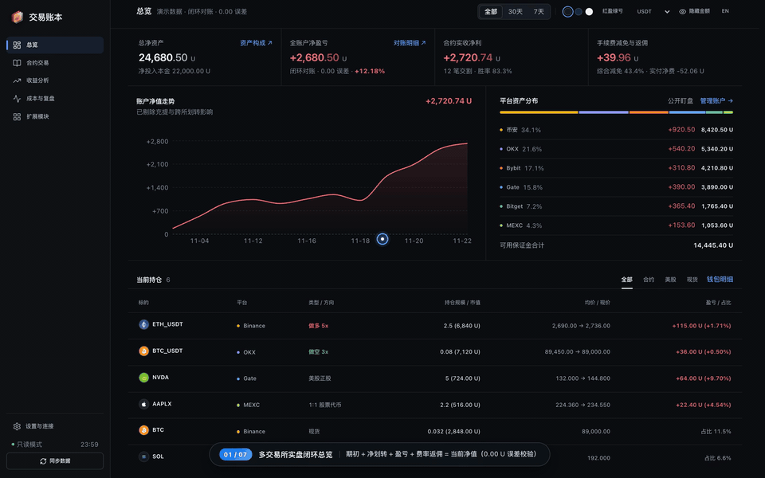
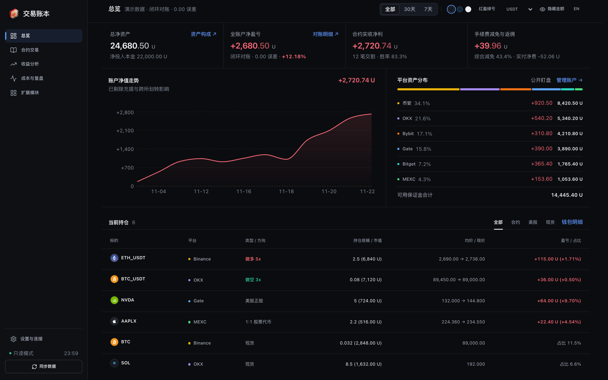
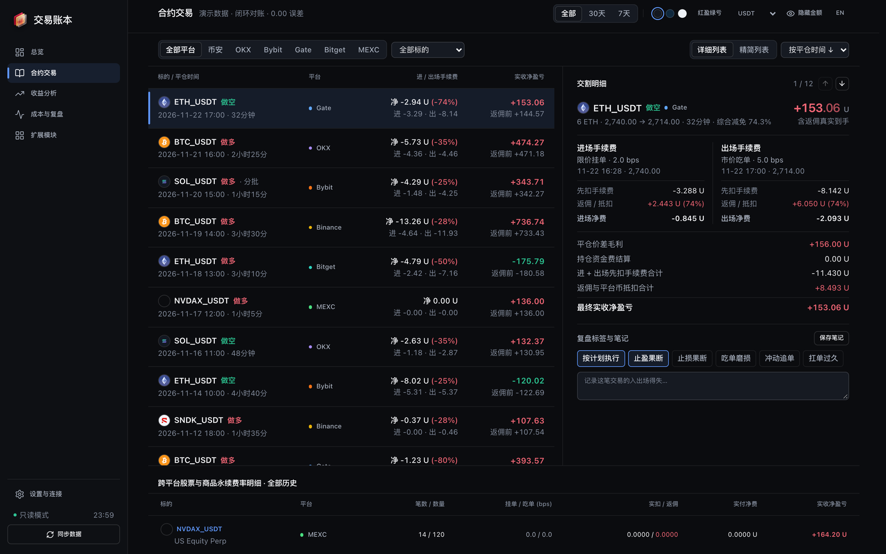
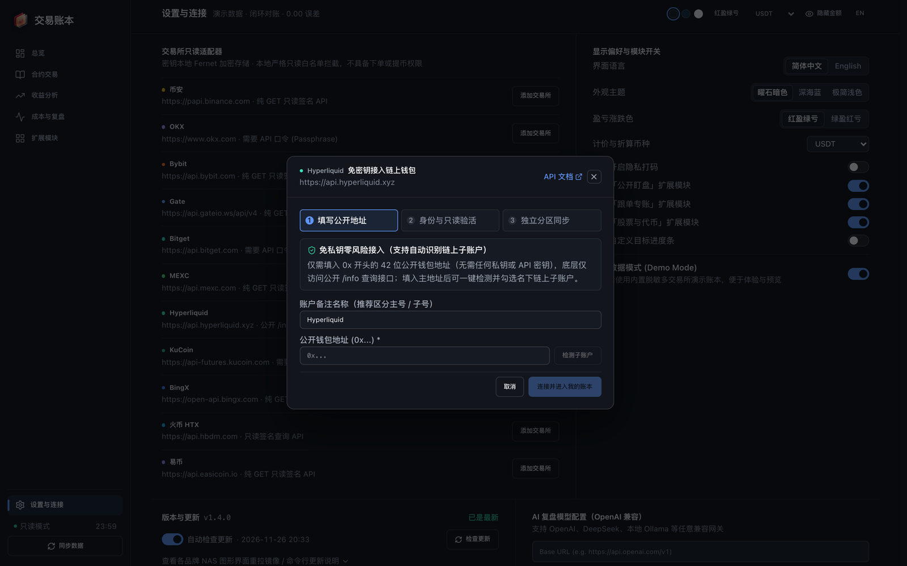
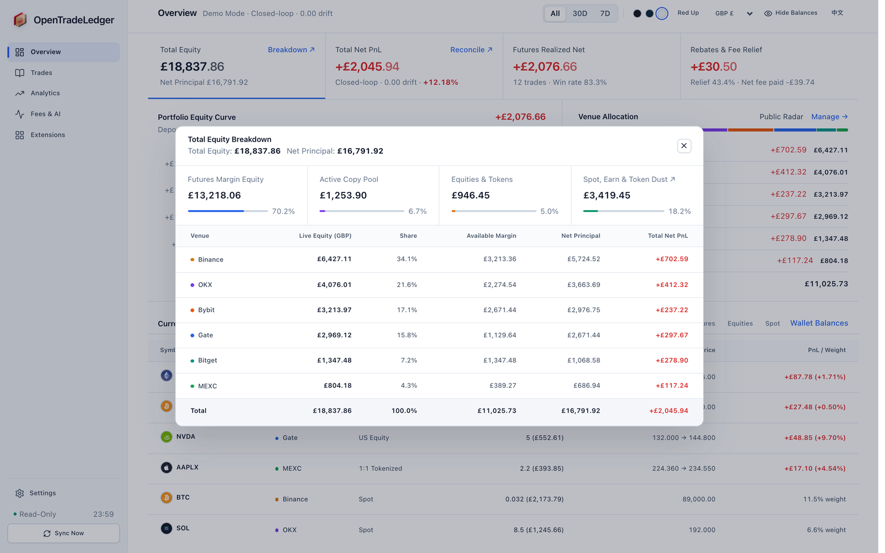

<div align="center">


# OpenTradeLedger · 交易账本

**Local-First, Strictly Read-Only Multi-Exchange Trade Ledger & Actuarial Accounting Engine**

[](https://github.com/KoalaPro/OpenTradeLedger/actions/workflows/ci.yml)
[](https://github.com/KoalaPro/OpenTradeLedger/pkgs/container/opentradeledger)
[](LICENSE)
[](pyproject.toml)
[](web/package.json)
[](backend/src/opentradeledger/security/readonly_guard.py)

[简体中文主文档 (README.md)](README.md) · [Architecture Reference](docs/PROJECT.md) · [Changelog](CHANGELOG.md) · [Contributing Guide](CONTRIBUTING.md)

</div>

---

## Live Demo & Screenshots

> All videos and screenshots below are captured in built-in **Demo Mode** using 100% synthetic data.

<div align="center">

[](docs/demo/opentradeledger-demo.mp4)

**[🎬 Watch / Download Full HD Demo Video (MP4 · 1600×1000)](docs/demo/opentradeledger-demo.mp4)**

</div>

### Overview — Hairline Ledger Layout, Multi-Exchange Holdings & `0.00 U` Closed-Loop Reconciliation (Obsidian Dark)


### Explicit Per-Leg Fee Disclosure — Independent Entry & Exit Fee Cards + Trade Journal


### 11 Read-Only Venues — Multi-Account Isolation & Keyless Hyperliquid `0x` Sub-Account Discovery


### Multi-Theme, Bilingual, Live GBP FX & Asset Structure Modal (Minimal Light EN)


---

## Key Capabilities

- **Closed-Loop Accounting (`0.00 U` Drift Check)**: Automatically reconciles `Opening Equity + Net Transfers + Realized PnL + Fees/Rebates + Funding + Unrealized PnL = Current Equity` per account partition.
- **Explicit Per-Leg Fee & Real-Time Rebate Disclosure**: Discloses **Entry Fee** and **Exit Fee** independently (Maker / Taker mode, effective bps, gross fee, settled rebates, and BNB/MX fee discounts).
- **11 Independent Read-Only Exchanges + Same-Venue Multi-Account**: Built-in support for **Binance**, **OKX (v5)**, **Bybit (v5)**, **Gate**, **Bitget (UTA)**, **MEXC**, **Hyperliquid (Keyless `0x` + Sub-Account Auto-Discovery)**, **KuCoin**, **BingX**, **HTX**, and **EasiCoin**, with remote UID deduplication (`DUPLICATE_ACCOUNT_UID`), `Main` / `Sub` role badges, and archive-on-disconnect support.
- **Public Copy-Trading Slot Radar & Bark Push**: Keyless public copy-trading slot monitor and inferred position tracker with customizable intervals and instant iOS Bark alerts.
- **Strict Local-First Security & One-Click NAS OTA Upgrade**: Runtime `GET`-only network guard, Fernet-encrypted `0600` local credential vault, `scrypt` LAN password lock, and browser-based SHA-256 verified OTA updates without mounting `docker.sock`.

---

## Quick Start

```bash
curl -fsSLO https://raw.githubusercontent.com/KoalaPro/OpenTradeLedger/main/docker-compose.yml
docker compose up -d
```

Open **http://127.0.0.1:8012** to explore Demo Mode immediately, or see [README.md](README.md) for full NAS GUI deployment instructions.

---

## License

MIT License — see [LICENSE](LICENSE).
