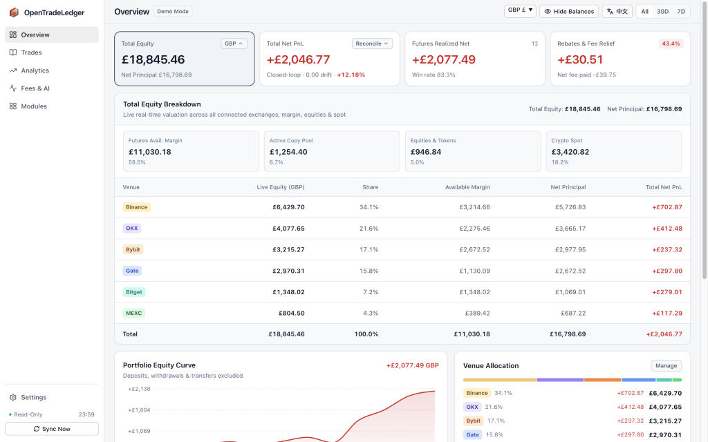

<div align="center">


# OpenTradeLedger · 交易账本

**Local-First, Strictly Read-Only Multi-Exchange Trade Ledger & Actuarial Accounting Engine**

[](https://github.com/KoalaPro/OpenTradeLedger/actions/workflows/ci.yml)
[](https://github.com/KoalaPro/OpenTradeLedger/pkgs/container/opentradeledger)
[](LICENSE)
[](pyproject.toml)
[](web/package.json)
[](backend/src/opentradeledger/security/readonly_guard.py)

[简体中文说明 (README.zh-CN.md)](README.zh-CN.md) · [Architecture Reference](docs/PROJECT.md) · [Contributing & Adapter Guide](CONTRIBUTING.md)

</div>

---

## Screenshots

> All screenshots below are captured in built-in **Demo Mode** using 100% synthetic data.

### Overview — Multi-Exchange Unified Holdings & Equity Curve (Obsidian Dark)


### Explicit Per-Leg Fee Disclosure — Independent Entry & Exit Fee Cards


### Multi-Theme, Bilingual, Live GBP FX & Interactive Equity Breakdown Drawer (Light EN)


---

## Why OpenTradeLedger?

Most open-source portfolio trackers focus on spot holdings without futures fee accounting, while most trading journals rely on manual CSV imports and ignore **maker/taker execution drag, real-time fee rebates, exchange token discounts, funding payments, and closed-loop balance reconciliation**.

**OpenTradeLedger (交易账本)** runs 100% locally on your computer or NAS, connects to exchanges exclusively via **read-only (`GET`-only) APIs**, and gives you an institutional-grade personal ledger:

- **Closed-Loop Accounting (`0.00 U` Drift Check) & Equity Breakdown Drawer**: Automatically reconciles `Opening Equity + Net Transfers + Realized PnL + Fees/Rebates + Funding + Unrealized PnL = Current Equity`. Click **Total Equity** for an animated 4-tile asset structure & per-exchange breakdown drawer, or open **Reconciliation** to inspect any cent-level drift.
- **Explicit Per-Leg Fee & Real-Time Rebate Disclosure**: Never hides costs behind a single lump sum. Every trade discloses **Entry Fee** and **Exit Fee** independently — including order mode (Maker / Taker / Stop / Reverse), effective bps rate, gross fee, settled real-time exchange rebates pulled directly from live rebate/bill streams (never guessed from static formulas), and separate notation for pre-deduction BNB/MX token discounts so every settlement waterfall reconciles to `0.0000`.
- **Unified Multi-Asset Holdings**: Consolidates **Futures**, **US Equities / 1:1 Tokenized Stocks**, and **Auto-Detected Crypto Spot** (automatically filtering stablecoins & `< $1` dust without double-counting stock tokens) with category filter pills and slide-over trade drill-down drawers.
- **Live 7-Currency FX Switching**: Switch the entire ledger instantaneously across `USDT`, `USD`, `CNY`, `GBP`, `EUR`, `HKD`, and `JPY` backed by live FX feeds (`open.er-api.com` + `frankfurter.dev` fallback, cached in SQLite).
- **Adaptive Idle-Account Backoff Polling**: Active accounts sync every `20s`; idle accounts (`< 20 U` equity with no open positions) automatically back off (`15m → 30m → 1h → 2h → 4h`) to save API quota, snapping straight back to `20s` on any balance delta (`>= 0.05 U`) or new activity.
- **4-Tier Automatic Instrument Logo Cache**: Automatically resolves crypto pairs (including `1000PEPE`-style multiplier contracts) and tokenized US stocks (`NVDAX`, `AAPLX`, `STOCK`, `ON`) into a 30-day local disk cache with deterministic SVG fallback.
- **Zero-Hardcode 11-Venue & Multi-Account Architecture**: Ships with 11 fully independent read-only adapters — **Binance**, **OKX (v5)**, **Bybit (v5)**, **Gate**, **Bitget (UTA)**, **MEXC**, **Hyperliquid (Keyless `0x`)**, **KuCoin**, **BingX**, **HTX**, and **EasiCoin**. Every exchange natively supports **multiple isolated accounts (Master, Sub-Accounts, and separate accounts)** with automatic remote UID verification, `Main` / `Sub` role badges, duplicate-UID anti-double-counting protection, and keyless `0x` sub-account discovery on Hyperliquid.
- **Strict Local-First Security & NAS Access Lock**:
  - Runtime `assert_readonly_request()` guard blocks any non-`GET` HTTP method and enforces per-venue read-only path allowlists before signing requests.
  - Credentials entered in the Web Settings UI are encrypted locally with **Fernet (AES-128-CBC + HMAC-SHA256)** using a `0600` local key file inside your `data/` directory. Zero cloud upload, zero telemetry.
  - **Built-in NAS / LAN Password Gate**: First-time live deployments present a welcome setup screen to set a local access password (`hashlib.scrypt` salted hash + `HttpOnly` signed session cookie with 30-day device remember, brute-force cooldown, one-click lock, and `--reset-password` local CLI recovery) paired with a smooth brand unlock ceremony — or skip for single-user desktop use.
  - **Honest API Health & Error Diagnostics**: Exchanges only display **Connected** when live verification/sync succeeds; any invalid key, IP whitelist rejection, clock drift, or timeout immediately flips the status to **API Error** with bilingual root-cause diagnostics and raw exchange error details.
- **OpenAI-Compatible AI Reviewer with Model Picker & Prompt Transparency**: Plug in any OpenAI-compatible LLM endpoint (OpenAI, DeepSeek, Ollama, OpenRouter, etc., supporting both `/chat/completions` and `/responses`), click **Fetch Models** (`/v1/models`) to select from live available models, inspect the exact 8 sanitized ledger dimensions sent to the AI (zero API keys, UIDs, or wallet addresses), or use the built-in zero-LLM bilingual local actuarial fallback.
- **Modern Personal Finance UX**:
  - **3 Themes**: Obsidian (default dark), Ocean (deep navy), and Light.
  - **Bilingual**: Instant `简体中文` / `English` switching.
  - **Regional PnL Polarity**: One-click switch between `Red Up / Green Down` (CN/Asia) and `Green Up / Red Down` (Global).
  - **Privacy Blur Mode**: One-click masking of all balances, PnL, and fee figures for safe screenshots or screen sharing.
  - **Public Copy-Trade Radar & Toggleable Modules**: Built-in keyless public copy-trading slot alarm (urgent iOS Bark ring + `bnc://` deep link when full traders open slots) and live inferred position tracking, toggleable Copy Trading & Equities modules, inline equity goal editor, and Bark alerts (monitoring remains available without a Bark device key).

---

## Supported Built-in Exchanges (Read-Only · Multi-Account & Sub-Account Ready)

| Exchange | Futures | Real-Time Rebates | Token Fee Discount | Copy Trading | Spot / Tokenized Stocks | Auth |
|---|:---:|:---:|:---:|:---:|:---:|---|
| **Binance** | ✓ | ✓ | ✓ (BNB) | ✓ | ✓ | API Key + Secret |
| **OKX (v5)** | ✓ | ✓ | ✓ (OKB) | ✓ | ✓ | API Key + Secret + Passphrase |
| **Bybit (v5)** | ✓ | ✓ | ✓ (MNT) | ✓ | ✓ | API Key + Secret |
| **Gate** | ✓ | ✓ | ✓ (GT/Points) | ✓ | ✓ | API Key + Secret |
| **Bitget (UTA)** | ✓ | ✓ | — | ✓ | ✓ | API Key + Secret + Passphrase |
| **MEXC** | ✓ | ✓ | ✓ (MX) | — | ✓ | API Key + Secret |
| **Hyperliquid** | ✓ | ✓ (Maker Rebates) | — | — | ✓ (Spot / HIP-3) | **Public `0x` Address (Zero Keys · Auto Sub-Account Discovery)** |
| **KuCoin** | ✓ | ✓ | ✓ (KCS) | — | ✓ | API Key + Secret + Passphrase |
| **BingX** | ✓ | ✓ | — | ✓ | ✓ | API Key + Secret |
| **HTX** | ✓ | ✓ | ✓ (HTX) | ✓ | ✓ | API Key + Secret |
| **EasiCoin** | ✓ | ✓ | — | — | ✓ | API Key + Secret |

Want to add Kraken, Coinbase, Backpack, or another venue? See [CONTRIBUTING.md](CONTRIBUTING.md)。

---

## Quick Start

### Option 1: Docker / NAS Pre-Built Image (Fastest — `amd64` & `arm64`)

Pre-built multi-arch images (`linux/amd64` and `linux/arm64`) are published automatically to GitHub Container Registry (`ghcr.io/koalapro/opentradeledger:latest`) — no `git` or local compilation required on your NAS:

```bash
curl -fsSLO https://raw.githubusercontent.com/KoalaPro/OpenTradeLedger/main/docker-compose.yml
docker compose up -d
```

Open **http://127.0.0.1:8012** to explore the full 6-page multi-exchange ledger immediately in sanitized Demo Mode.

**Switching to Live NAS Deployment & Upgrading Later**:
1. Create a `.env` file next to `docker-compose.yml` containing `OTL_DEMO_MODE=false` and run `docker compose up -d`.
2. Set your local NAS access password on first open, then add **read-only** API keys in **Settings → Connected Exchanges**.
3. **New Version Detection & One-Click Upgrade**: Deployed instances automatically check GitHub Releases (read-only, zero telemetry, 6h cache, toggleable in Settings) and display a version badge when an update is out. Because `./data` is mounted outside the container, upgrading preserves all passwords, encrypted keys, and historical trades:
   ```bash
   docker compose pull && docker compose up -d
   ```
   *(Or click **Update Image** directly in Synology Container Manager, fnOS Docker, Portainer, or Watchtower.)*

### Option 2: Local Development (Python + Node.js)

**Prerequisites**: Python 3.11+ and Node.js 20+.

```bash
# 1. Install backend dependencies
python3 -m venv .venv
source .venv/bin/activate
pip install -e ".[dev]"

# 2. Build the frontend SPA
cd web
npm install
npm run build
cd ..

# 3. Launch in Demo Mode (zero API keys required)
python scripts/run_server.py --demo --port 8012
```

For live mode pointing to a custom local data folder (SQLite DB + encrypted vault + logo cache):

```bash
python scripts/run_server.py --host 127.0.0.1 --port 8012 --data-dir ./data
```

---

## Architecture Overview

```text
OpenTradeLedger/
├── .github/workflows/ci.yml   # Automated privacy audit, pytest, typecheck, vitest & build
├── backend/
│   ├── src/opentradeledger/
│   │   ├── security/          # Strict GET-only guard & Fernet credential vault
│   │   ├── adapters/          # 7 independent exchange modules (client.py + sync.py + accounting.py)
│   │   ├── core/              # Venue-partitioned SQLite WAL store, venue-agnostic ledger aggregator,
│   │   │                      # adaptive sync manager, live FX rates, 4-tier logo cache,
│   │   │                      # AI reviewer, multi-channel notifier
│   │   └── api/               # FastAPI v1 REST API + SPA static server
│   └── tests/                 # Pytest suite (security, adapters, ledger, API)
├── web/
│   └── src/
│       ├── assets/            # Brand icon
│       ├── styles/            # Tailwind CSS v4 + Obsidian/Ocean/Light themes & motion
│       ├── i18n/              # Built-in zh-CN and en dictionaries
│       ├── components/        # Sidebar, TopBar, EquityChart, MonthlyCalendar, DrilldownDrawer
│       └── pages/             # Overview, Trades, Analytics, Fees & AI, Modules, Settings
├── docs/screenshots/          # Sanitized Demo Mode showcase screenshots
├── scripts/
│   ├── run_server.py          # Unified CLI entrypoint
│   └── privacy_audit.py       # Pre-commit secret & PII static scanner
├── Dockerfile
└── docker-compose.yml
```

---

## Security & Verification

Run the full test suite and built-in privacy gate before pushing any changes:

```bash
python scripts/privacy_audit.py
pytest -q backend/tests
cd web && npm run typecheck && npm run test && npm run build
```

> **Security Note**: Always restrict exchange API keys to **Read-Only** permissions (disable Spot/Futures Trading, Withdrawals, and Internal Transfers) and enable IP whitelisting wherever supported by your exchange.

---

## License

MIT License — see [LICENSE](LICENSE).
