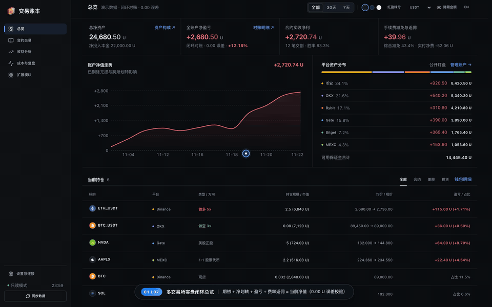
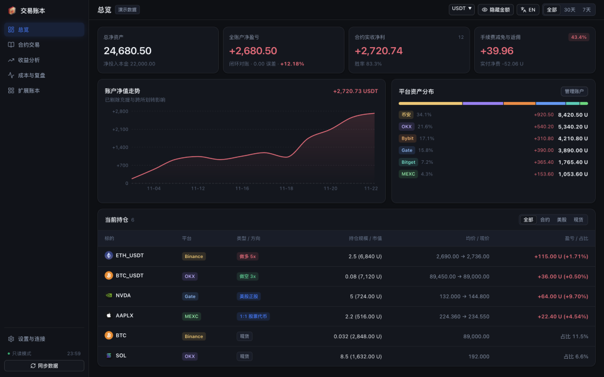
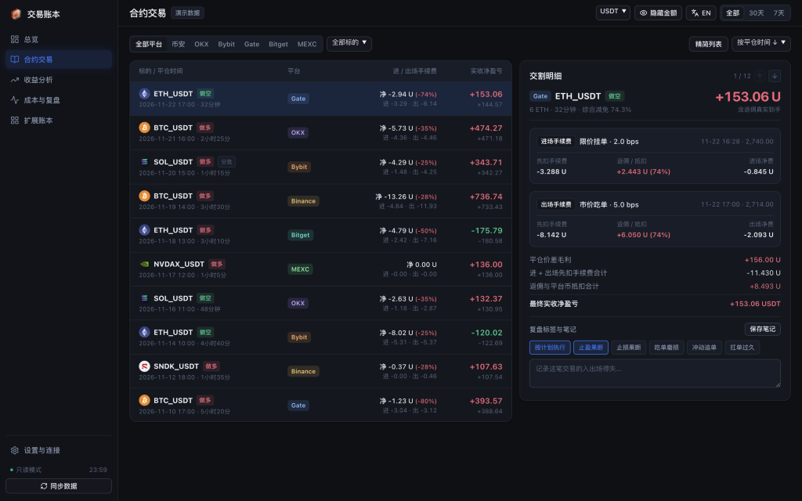
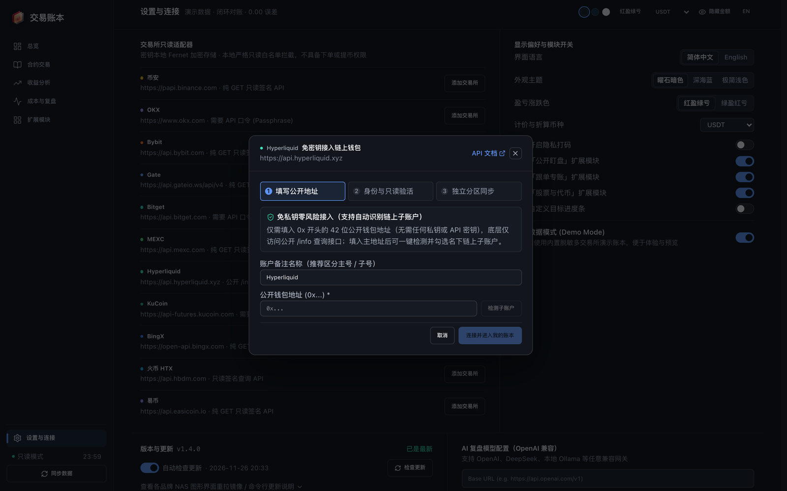

<div align="center">


# 交易账本 · OpenTradeLedger

**部署在电脑或 NAS 上的多交易所只读账本，逐笔核对成交、手续费、资金费和实际盈亏。**

[](https://github.com/KoalaPro/OpenTradeLedger/actions/workflows/ci.yml)
[](https://github.com/KoalaPro/OpenTradeLedger/pkgs/container/opentradeledger)
[](LICENSE)
[](pyproject.toml)
[](web/package.json)
[](backend/src/opentradeledger/security/readonly_guard.py)

[项目与架构说明](docs/PROJECT.md) · [版本更新日志](CHANGELOG.md) · [贡献与新增交易所指南](CONTRIBUTING.md) · [English Documentation (README.en.md)](README.en.md)

</div>

---

## 实机演示与界面预览

> 以下演示视频与界面截图均在内置 **演示模式（Demo Mode）** 下录制，采用 100% 模拟脱敏数据，开箱免密钥即可体验完整功能。

### 全流程实机演示（点击下方链接可观看 / 下载 1600×1000 高清 MP4 视频）

<div align="center">

[](docs/demo/opentradeledger-demo.mp4)

**[🎬 点击观看 / 下载高清完整演示视频（MP4 · 1600×1000）](docs/demo/opentradeledger-demo.mp4)**

</div>

### 总览页 — 细线原生账本布局、多交易所统一持仓与 `0.00 U` 闭环核账（曜石暗色）


### 进场与出场手续费


### 11 大交易所严格只读接入 — 同所多账号（主/子账户识别）与 Hyperliquid 免私钥 `0x` 发现


### 多主题、中英文、7 币种实时汇率（GBP）与总净资产构成明细弹窗（极简浅色）


---

## 为什么做「交易账本」？

市面上的开源资产看板大多只覆盖现货余额，缺乏永续合约逐腿手续费、真实返佣流水与资金费精算；而多数交易复盘工具仍停留在手工上传 CSV，既无法自动核对多交易所真实净值，也常把整笔交易成本糊成一个总数字。

**交易账本（OpenTradeLedger）** 100% 运行在你自己的电脑或家庭 NAS 上，**仅通过只读 API 连接交易所**，专注解决实盘交易者最关心的账务准确性、多账号汇总与复盘效率：

- **闭环恒等式核账（`0.00 U` 误差校验）与资产构成穿透**：按平台与账户分区独立验证 `期初权益 + 净充提划转 + 已实现盈亏 + 手续费与真实返佣 + 资金费 + 未实现盈亏 = 当前真实净资产`。点击 **资产构成** 查看合约保证金、跟单专账、正股/代币化美股与现货理财四维占比，点击 **对账明细** 逐项复核每一分钱差额。
- **进场 / 出场双腿手续费独立明示与实时返佣实算**：拒绝笼统的“总手续费”。每笔平仓并排拆解 **进场腿** 与 **出场腿** 成本卡片——清晰列出成交类型（挂单 Maker / 吃单 Taker / 止损 / 反手）、实测有效费率（bps）、毛手续费、来自交易所真实账单流水的实收返佣（绝不套静态比例估算）以及 BNB / MX 等平台币抵扣说明；原始接口未提供分腿明细时诚实标注 `分腿费用未知` 并完整纳入成本矩阵。
- **分批平仓**按一段连续持仓归为一笔交易。展开时间线可核对每次加仓、减仓和最终平仓的成交，以及交易所提供的手续费明细。
- **11 平台全独立对等架构 & 同交易所多账号（主账户 / 子账户 / 独立号）隔离核账**：
  - 开箱内置 **币安 Binance**、**OKX (v5)**、**Bybit (v5)**、**Gate**、**Bitget (UTA)**、**MEXC**、**Hyperliquid（链上免密钥 `0x`）**、**KuCoin（库币）**、**BingX**、**火币 HTX**、**易币 EasiCoin** 11 套完全解耦的只读适配器。
  - **全平台原生支持同一交易所绑定多个账号**：自动探测远端脱敏 `UID` 并识别 `主账户` / `子账户` / `链上钱包` 身份徽标，内置重复 `UID` 冲突拦截（杜绝同一账户两把 Key 导致总净资产翻倍）与换钥归属校验（防止跨账号串账）；Hyperliquid 仅需填入公开 42 位 `0x` 地址即可免私钥同步，并支持一键探测勾选导入名下链上子账户。
  - **封存保留与数值强校验**：解绑 API Key 时可选择「仅解绑凭证、保留本地历史（已封存）」或「彻底清除分区数据」；全平台内置钱包金额有限数强校验与子接口局部异常防写小保护，绝不因上游瞬时繁忙或畸形返回冲掉已有资产。
- **免密钥公开带单盯盘雷达 & iOS Bark 秒级提醒**：无需任何 API Key 即可监控公开带单员跟单余位与实时成交流推算持仓，支持自定义扫描频率（最低 `3 秒` 极速抢位），车位释放或带单调仓时通过 iOS Bark 推送即时响铃并直跳交易所 App。
- 启用**个人账本 Bark 提醒**后，同一账户在一次同步中新入账的减仓和平仓会合并推送。首次导入历史、重复同步、开仓和加仓均保持静默。
- **多资产统一总览与 7 币种实时汇率瞬切**：合约在途仓位、美股正股 / 1:1 代币化股票与全账户现货尾仓同屏呈现；顶栏一键在 `USDT`、`USD`、`CNY`、`GBP`、`EUR`、`HKD`、`JPY` 之间实时换算全部净值与图表。
- **通用 AI 智能复盘（数据外发四态透明披露）**：兼容任意 OpenAI 格式接口（DeepSeek、OpenAI、Ollama、OpenRouter 等），支持在线拉取模型列表点选；严格仅发送 8 项脱敏聚合指标（零 API Key、零 UID、零原始订单号），并明确标注 `0 笔成交本地短路`、`纯本地精算`、`远端异常回退本地`、`远端模型生成` 四类状态。
- **本地优先安全防线与跨品牌 NAS 网页一键升级**：
  - 交易所适配器通过 `readonly_guard.py` 限定只读访问。Hyperliquid 使用公开钱包地址调用 `POST /info`，仅允许预先列明的查询类型。API 凭证经 **Fernet（AES-128-CBC + HMAC-SHA256）** 本地 `0600` 权限加密落盘；内置 `scrypt` 局域网访问密码锁与 `--reset-password` 本地恢复命令。
  - **网页内一键在线升级（OTA）**：检测到新版本后直接在设置页点击「一键在线升级」，自动完成官方 Release 包 SHA-256 校验与秒级热切换，无需 SSH 终端、无需挂载高危 `docker.sock`。

---

## 内置只读交易所支持一览

| 交易所 | 合约账本 | 实时返佣 / 挂单返费 | 平台币抵扣 | 同所多账号 & 主/子识别 | 现货 / 代币化美股 | 只读鉴权方式 |
|---|:---:|:---:|:---:|:---:|:---:|---|
| **币安 Binance** | ✓ | ✓ | ✓ (BNB) | ✓ | ✓ | API Key + Secret |
| **OKX (v5)** | ✓ | ✓ | ✓ (OKB) | ✓ | ✓ | API Key + Secret + Passphrase |
| **Bybit (v5)** | ✓ | ✓ | ✓ (MNT) | ✓ | ✓ | API Key + Secret |
| **Gate** | ✓ | ✓ | ✓ (GT/点卡) | ✓ | ✓ | API Key + Secret |
| **Bitget (UTA)** | ✓ | ✓ | — | ✓ | ✓ | API Key + Secret + Passphrase |
| **MEXC** | ✓ | ✓ | ✓ (MX) | ✓ | ✓ | API Key + Secret |
| **Hyperliquid** | ✓ | ✓ (Maker 返费) | — | ✓（自动发现链上子账户） | ✓ (链上现货 / HIP-3) | **免密钥公开 `0x` 钱包地址** |
| **KuCoin（库币）** | ✓ | ✓ | ✓ (KCS) | ✓ | ✓ | API Key + Secret + Passphrase |
| **BingX** | ✓ | ✓ | — | ✓ | ✓ | API Key + Secret |
| **火币 HTX** | ✓ | ✓ | ✓ (HTX) | ✓ | ✓ | API Key + Secret |
| **易币 EasiCoin** | ✓ | ✓ | — | ✓ | ✓ | API Key + Secret |

需要扩展 Kraken、Coinbase、Backpack 等更多平台？请参考 [CONTRIBUTING.md](CONTRIBUTING.md)。

---

## 快速开始

### 方式一：全品牌 NAS 图形界面零终端部署（极空间 / 绿联 / 飞牛 fnOS / 群晖 / 威联通通用）

无需开启 SSH、无需敲命令行，也无需手动编辑隐藏 `.env` 文件：

1. **打开 NAS 自带的「Docker」应用 → 选择「Compose / 项目」→ 点击「新增项目」**，直接粘贴下方配置创建（中国大陆网络推荐直接使用下方南京大学 GHCR 镜像加速源，支持 `amd64` 与 `arm64` 双架构；海外环境可改为 `ghcr.io/koalapro/opentradeledger:latest`）：

```yaml
services:
  opentradeledger:
    image: ghcr.nju.edu.cn/koalapro/opentradeledger:latest
    container_name: opentradeledger
    ports:
      - "8012:8012"   # 如 8012 端口已被占用，直接修改左侧数字（如 "8013:8012"）即可
    environment:
      OTL_HOST: "0.0.0.0"
      OTL_PORT: "8012"
      OTL_DATA_DIR: "/app/data"
      OTL_DEMO_MODE: "true"
    volumes:
      - ./data:/app/data
    restart: unless-stopped
```

2. **浏览器访问 `http://你的NAS局域网IP:8012`（或自定义端口）**：
   - 首次打开默认进入脱敏**演示模式**，可直接浏览全部六大页面；
   - 准备接入实盘时，前往 **「设置与连接」** 添加首个只读交易所账号（或关闭「演示数据模式」开关），系统会自动引导设置本地访问密码并切入正式账本。
3. **后续升级**：在「设置与连接 → 版本与更新」中点击 **「一键在线升级」** 即可自动完成校验与热更新，密码、加密密钥和历史账单 100% 保留。

### 方式二：本机直接运行（Python 3.11+ & Node.js 20+）

```bash
# 1. 安装后端依赖
python3 -m venv .venv
source .venv/bin/activate
pip install -e ".[dev]"

# 2. 构建前端静态资源
cd web
npm install
npm run build
cd ..

# 3. 启动演示模式（无需任何 API Key）
python scripts/run_server.py --demo --port 8012
```

正式实盘模式指定本地数据目录启动：

```bash
python scripts/run_server.py --host 127.0.0.1 --port 8012 --data-dir ./data
```

---

## 目录结构

```text
OpenTradeLedger/
├── .github/workflows/           # CI 门禁、多架构 GHCR 镜像构建与 GitHub Release / OTA 打包流水线
├── backend/
│   ├── src/opentradeledger/
│   │   ├── adapters/            # 11 大交易所全独立只读包（client.py / sync.py / accounting.py）
│   │   ├── api/                 # FastAPI 路由装配（app.py / routes_exchanges.py / schemas.py / http_helpers.py）
│   │   ├── core/                # 多账号分区代理、SyncManager、LedgerService、实时汇率、公开盯盘、AI 复盘、OTA 升级
│   │   └── security/            # 交易所只读访问控制、Fernet 密钥保险箱、scrypt 本地会话锁
│   └── tests/                   # 按业务领域组织的后端单元/精算/安全与架构 AST 守卫测试套件
├── web/
│   └── src/
│       ├── components/          # 细线账本通用组件、settings/ 设置页弹窗与卡片子组件、顶栏与图标库
│       ├── pages/               # 总览、合约交易、收益分析、成本与复盘、扩展模块、设置与连接六大页面
│       ├── styles/              # 曜石暗色 / 深海蓝 / 极简浅色主题令牌与弹簧微动效
│       └── __tests__/           # Vitest + Testing Library 前端交互与跨模块契约测试
├── docs/
│   ├── PROJECT.md               # 核心架构边界与核账口径文档
│   ├── demo/                    # 高清实机功能演示视频（MP4）
│   └── screenshots/             # 演示模式动图预览与界面截图
└── scripts/
    ├── run_server.py            # 统一服务入口（支持 OTA 热更新槽位自动挂载）
    └── privacy_audit.py         # 提交前隐私、密钥与内网信息静态扫描门禁
```

---

## 测试与隐私安全门禁

```bash
python scripts/privacy_audit.py
PYTHONPATH=backend/src pytest -q backend/tests
cd web && npm run typecheck && npm run test && npm run build
```

> **安全提醒**：在交易所创建 API Key 时，请务必**仅勾选只读权限（Read-Only）**，严格关闭现货交易、合约交易、内部划转和提币权限，并建议绑定可信 IP 白名单。

---

## 开源协议

本项目基于 [MIT License](LICENSE) 开源。
